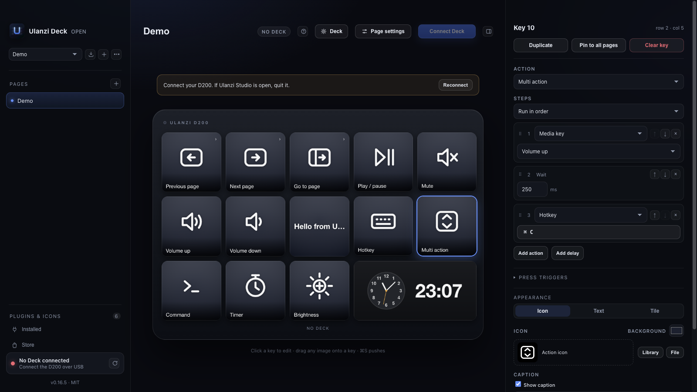

# ulanzi-deck-open

An open-source desktop app for the **Ulanzi D200** (14 buttons: 13 square 196×196 keys
plus one 2×1 wide key, USB `0x2207:0x0019`). It replaces Ulanzi Studio for editing pages and triggering
actions, and it talks to the deck directly over HID — no vendor app required.



## Features

* **Live editor** — mirrors the device exactly: 13 square keys + one 2×1 wide key
  (slot `3_2`, index 13).
* **Pages** — multiple pages, page-switch keys, auto-push on edit.
* **Keys** — emoji, label, background colour, or a custom image (click or drag & drop).
  The wide key renders at 402×196.
* **Actions** — open an app (searchable in-app picker with real app icons and a
  “Use app icon” button), open a URL
  (fetches the site's icon automatically), run a shell command, send a hotkey, switch
  page, **or run an existing Node.js Ulanzi plugin action**.
* **Device control** — brightness (0–100 %), screen sleep timeout, clock sync.
* **Plugins** — runs Ulanzi's JavaScript plugins unchanged (discovery, WebSocket host,
  live images, key events). Plugins installed by Ulanzi Studio are used read-only and
  can be copied into the app; app-installed plugins can be removed.
  See [`docs/PLUGINS.md`](docs/PLUGINS.md).
* **Plugin Store** — browse the official Ulanzi Studio marketplace from the sidebar:
  categories, search, sorting, plugin details, and one-click install into this app
  (installed plugins are fully managed by it).
* **Hotkeys** — a proper picker (modifiers, letters, symbols, function keys, F keys,
  numpad) plus physical key capture.
* **Drag to rearrange** — drag a key onto another to swap them.
* **Wide key is read-only** — it is the firmware system panel (clock), not user-editable.
* **Lives in the menu bar** — closing the window hides it; Cmd+Q asks for confirmation
  before quitting.
* **Packaged macOS app** — `npm run package` builds `Ulanzi Deck Open.app`.

The window, the editor, and the device all update from the same config, so what you
see is what the deck shows (labels are rendered into the images).

## Quick start

```bash
cd app
npm install
npm start
```

**Quit Ulanzi Studio first** — the deck's control interface is exclusive.

Hotkey actions are sent through AppleScript / System Events, so macOS asks for
Accessibility permission the first time. Open-app/URL and shell actions need no
special permission.

Build and install the standalone app:

```bash
npm run install-app    # package, copy to ~/Applications, register with Spotlight
npm run package        # arm64 only, no install
npm run package:all    # universal
```

`install-app` also refreshes the LaunchServices/Spotlight registration, so the app
shows up in Spotlight's Applications and Launchpad after every build.

Config lives in `~/Library/Application Support/Ulanzi Deck Open/config.json`.

## Roadmap

Importing profiles from Ulanzi Studio, action-model parity (multi-action, press
types, system actions) and editor polish are planned in [`docs/ROADMAP.md`](docs/ROADMAP.md).

## Project layout

```
app/                 Electron GUI (the app)
  main.js            window, IPC, tray-less lifecycle
  preload.js         context-isolated bridge
  lib/protocol.js    frame encoding/decoding
  lib/deck.js        node-hid transport, read loop, key events
  lib/page.js        page ZIP builder (content-addressed PNGs)
  lib/store.js       config schema + defaults
  lib/actions.js     open/hotkey/command execution
  lib/plugins.js     Ulanzi plugin host (spawn, WebSocket, images)
  renderer/          UI (HTML/CSS/JS, canvas key rendering)
ulanzi_deck/         small Python library and protocol prototype
examples/hello.py    Python: draw a numbered page on the deck
docs/PROTOCOL.md     reverse-engineered USB/HID protocol
```

## What works / what's next

Working today: device connection, page upload, key input, page switching, native
actions, brightness/sleep, packaging.

Not implemented yet:

* HTML plugins and plugin property-inspector UI (JS plugin actions work; settings are JSON).
* Plugin auto-restart after a crash.
* The wide (2×1) key panel: the firmware shows the clock/logo, but the vendor’s
  clock/stats mode command is not identified yet. The wide key is not offered as a
  normal action.
* The firmware fallback that types `www.ulanzistudio.com` when the keyboard HID
  collection is not seized (needs an in-app native seize; a helper is blocked by TCC).
* Multi-state keys, folders, GIF playback, dial/knob devices (D200H/D200X).
* A proper settings pane (the first version exposes the essentials inline).

## Protocol

See [`docs/PROTOCOL.md`](docs/PROTOCOL.md). In short:

```
frame  = 7C 7C | cmd | proto | u32 length | payload   (padded to 1024 bytes)
host   = HID output reports: 0x00 + 1024-byte chunk
device = HID input reports:  1024-byte chunk
```

Pages are a ZIP with `manifest.json` (`"column_row"` → `Icon` / `Text` / `Font`) and
`Images/*.png`. Key events arrive as `cmd=0x01 proto=0x01`, payload
`01 <index> 01 <state>`.

## Development notes

* The app is Electron 45 + `node-hid` (N-API) + `jszip`, no bundler. The renderer is
  plain HTML/CSS/JS so it is easy to hack on.
* `ULANZI_SHOT=/tmp/ui.png` renders the window to a PNG and exits (useful for CI
  screenshots). `ULANZI_CLICK=5` selects a key first; `ULANZI_KEY=7` simulates a
  device key press.
* The Python prototype remains for protocol experiments:
  `python3 -m venv .venv && .venv/bin/pip install pillow && .venv/bin/python examples/hello.py`.

## Legal

Independent interoperability project. No Ulanzi code or assets are included.
Protocol facts were obtained by observing USB traffic on hardware we own.

MIT licensed.
